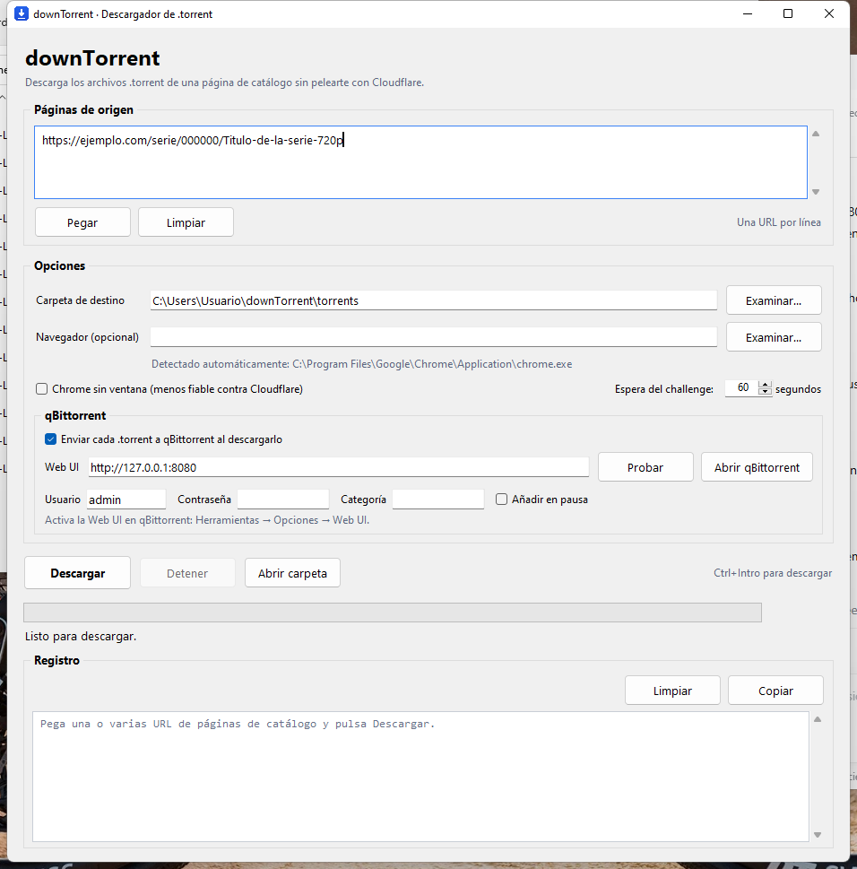

# downTorrent

Script de línea de comandos —y aplicación de escritorio— que descarga los archivos
`.torrent` enlazados en una o varias páginas de un catálogo web, sorteando el
*managed challenge* de Cloudflare.

> **Aviso legal.** Esta herramienta solo descarga archivos de metadatos `.torrent`
> desde páginas públicas y no aloja, distribuye ni enlaza contenido protegido.
> Úsala únicamente con material sobre el que tengas derechos o que sea de dominio
> público, y respeta las condiciones de uso de los sitios que visites y la
> legislación de tu país. El autor no se responsabiliza del uso que se haga de ella.

## ¿Cómo funciona?

Una petición HTTP normal o un navegador lanzado por Playwright es detectado por
Cloudflare y el challenge nunca se resuelve. La estrategia del script es la contraria:
lanzar un Chrome **real** como proceso independiente y conectarse a él por CDP.

1. **Chrome independiente.** Se arranca con `--remote-debugging-port` y un perfil
   persistente (`~/.downtorrent/chrome-profile`) que conserva las cookies
   (`cf_clearance`) entre ejecuciones, así que el navegador parece un visitante
   habitual. Sin marcas de automatización.
2. **Playwright por CDP.** Se conecta con `connect_over_cdp` al Chrome ya lanzado,
   en lugar de lanzarlo él mismo.
3. **DNS-over-HTTPS.** Los dominios del sitio se resuelven con DoH (1.1.1.1) y se
   fuerzan en el navegador con `--host-resolver-rules`, saltándose bloqueos de DNS
   del ISP. Los dominios del challenge de Cloudflare se dejan al DNS normal para no
   romper el widget de verificación.
4. **Espera del challenge.** Se vigila el título de la pestaña hasta que deja de
   contener los marcadores típicos (`moment`, `checking`, `verificando`, …).
5. **Descarga.** Se extraen los `a[href$=".torrent"]` y cada archivo se descarga con
   `fetch` desde el contexto de la página, reutilizando cookies y clearance. Se
   omiten los archivos que ya existen y se descartan respuestas HTML o de menos de
   50 bytes (síntoma de challenge sin resolver).

La interfaz gráfica ejecuta exactamente este flujo en un hilo aparte: la ventana
sigue respondiendo, muestra el progreso y el registro, y permite detener la
descarga de forma ordenada.

## Requisitos

- Python 3.9 o superior (probado con 3.11, 3.12 y 3.13). Usa una instalación
  **estándar** de <https://www.python.org/>. El Python de Microsoft Store se ejecuta
  a integridad baja y Chrome no puede arrancar desde él.
- Chrome, Chromium, Brave o Edge instalado en el sistema. **No** hace falta ejecutar
  `playwright install`: el script usa el navegador del sistema vía CDP.
- La interfaz gráfica usa Tkinter, incluido en las instalaciones oficiales de
  Python. En Linux puede requerir el paquete del sistema `python3-tk`.

## Instalación

El script es multiplataforma (macOS, Linux y Windows) y no necesita ningún paso de
compilación: basta con Python y un navegador Chromium. El `venv` es específico de
cada sistema operativo, así que **no** lo copies de un equipo a otro: créalo en cada
máquina.

### macOS / Linux

```bash
git clone https://github.com/ceciliofdz/downTorrent.git
cd downTorrent

python3 -m venv venv
source venv/bin/activate

pip install -r requirements.txt
```

### Windows

1. Instala Python 3.9 o superior. La forma más rápida, en PowerShell:

   ```powershell
   winget install -e --id Python.Python.3.12
   ```

   O descárgalo de <https://www.python.org/downloads/windows/> y marca
   **«Add python.exe to PATH»** durante la instalación.

2. Descarga el proyecto (con Git, o bajando el ZIP desde GitHub y descomprimiéndolo):

   ```bat
   git clone https://github.com/ceciliofdz/downTorrent.git
   cd downTorrent
   ```

3. Crea el entorno virtual e instala las dependencias, desde **cmd** (o desde
   PowerShell usando `venv\Scripts\Activate.ps1`):

   ```bat
   py -m venv venv
   venv\Scripts\activate
   pip install -r requirements.txt
   ```

4. Comprueba que se detecta el navegador y ejecuta:

   ```bat
   python downtorrent.py --help
   python downtorrent.py "https://ejemplo.com/serie/000000/Titulo-de-la-serie"
   ```

Si Python no está en el `PATH`, usa el lanzador `py` en lugar de `python`, y si el
navegador no se detecta, pasa su ruta con `--executable` (ver más abajo).

## Uso

```bash
# Una página
python downtorrent.py "https://ejemplo.com/serie/000000/000000/Titulo-de-la-serie"

# Varias páginas a la vez
python downtorrent.py URL1 URL2 URL3

# Carpeta de destino distinta y más tiempo para el challenge
python downtorrent.py URL -o torrents --timeout 120

# Forzar un navegador concreto
python downtorrent.py URL --executable "/Applications/Chromium.app/Contents/MacOS/Chromium"

# En Windows (cmd), con la ruta entre comillas si tiene espacios
python downtorrent.py URL --executable "C:\Program Files\Google\Chrome\Application\chrome.exe"

# Interfaz gráfica
python downtorrent.py --gui
```

### Opciones

| Opción | Descripción | Por defecto |
| --- | --- | --- |
| `urls` | Una o varias URLs de páginas de las que extraer los `.torrent`. | — |
| `--gui` | Abre la interfaz gráfica en lugar de descargar desde la consola. | desactivado |
| `-o`, `--salida` | Carpeta donde se guardan los archivos descargados. | `torrents` |
| `--headless` | Ejecuta Chrome sin ventana. Menos fiable contra Cloudflare. | desactivado |
| `--executable` | Ruta al binario de Chrome/Chromium si no se detecta automáticamente. | autodetección |
| `--timeout` | Segundos máximos esperando a que se resuelva el challenge. | `60` |
| `-h`, `--help` | Muestra la ayuda. | — |

La lista de rutas de navegador que se prueban está en `RUTAS_NAVEGADOR`; si tu
navegador no aparece ahí, usa `--executable`.

## Interfaz gráfica

La aplicación de escritorio usa Tkinter y el mismo núcleo que el script. No añade
dependencias de Python: Tkinter viene incluido en la instalación oficial (en Linux,
consulta los requisitos del paquete `python3-tk`).



### Cómo abrirla

- **Windows:** doble clic en `iniciar_gui.bat`.
- **macOS / Linux:** `python3 downtorrent_gui.py` o `sh iniciar_gui.sh`.
- **Desde el script principal:** `python downtorrent.py --gui`.

> **Importante:** ábrela con doble clic desde el Explorador (o con `Win+R`),
> **no desde la terminal del agente**. Esa terminal puede ejecutarse en un
> sandbox que impide a Chrome arrancar; la aplicación lo detecta y muestra un
> aviso claro en el registro.

Con el entorno virtual activado también puedes ejecutar `python downtorrent_gui.py`
directamente.

### Qué permite hacer

- Pegar una o varias URLs (una por línea) y descargarlas con un botón.
- Elegir la carpeta de destino y abrirla con el explorador de archivos.
- Ajustar el tiempo de espera del challenge, ejecutar Chrome sin ventana o indicar
  un navegador concreto (si se deja vacío, se detecta automáticamente).
- Enviar cada `.torrent` a qBittorrent en cuanto se descarga correctamente.
- Ver el progreso y el registro detallado en tiempo real.
- Detener la descarga sin cerrar la ventana: se termina la operación en curso y se
  cierra Chrome de forma ordenada.
- Recordar la carpeta, el navegador, el tiempo de espera y el tamaño de la ventana
  entre ejecuciones.

Atajos: `Ctrl+Intro` o `F5` inician la descarga.

### Enviar a qBittorrent

La interfaz puede entregar cada `.torrent` a qBittorrent en cuanto se descarga
correctamente, para que empiece a bajarlo:

1. En qBittorrent, activa **Herramientas → Opciones → Web UI** y comprueba el
   puerto (por defecto `8080`) y el usuario/contraseña.
2. En downTorrent, marca **Enviar cada .torrent a qBittorrent al descargarlo**.
3. Rellena la dirección (`http://127.0.0.1:8080`), el usuario y la contraseña, y
   pulsa **Probar**. Si qBittorrent no está abierto, usa **Abrir qBittorrent**.
   Si no recuerdas la contraseña, puedes establecer una nueva en esa misma
   pantalla de qBittorrent.
4. Opcionalmente indica una categoría o marca **Añadir en pausa**.

Cada archivo descargado se envía inmediatamente. Si el envío falla, el `.torrent`
se conserva en la carpeta de destino y el registro muestra el error; la descarga
de los demás continúa.

Las preferencias se guardan en `~/.downtorrent/gui.json`
(`C:\Users\<usuario>\.downtorrent\gui.json` en Windows). Es un archivo pequeño de
configuración; no contiene cookies ni datos de sesión.

## Salida

Los `.torrent` se guardan en la carpeta indicada (por defecto `torrents/`),
conservando el nombre de archivo del enlace. Los que ya existen con tamaño mayor que
cero se omiten, así que se puede relanzar el script sin volver a descargarlo todo.

## Estructura del proyecto

```
.
├── downtorrent.py       # núcleo y línea de comandos
├── downtorrent_gui.py   # interfaz gráfica (Tkinter)
├── qbittorrent.py       # cliente de la API Web de qBittorrent
├── iniciar_gui.bat      # lanzador para Windows
├── iniciar_gui.sh       # lanzador para macOS/Linux
├── assets/
│   ├── icono.png        # icono de la ventana
│   └── icono.ico        # icono del acceso directo
├── docs/
│   └── captura-gui.png  # captura para este README
├── requirements.txt     # dependencias
├── README.md
├── LICENSE
└── .gitignore
```

## Privacidad

El perfil de Chrome se guarda **fuera** del repositorio, en
`~/.downtorrent/chrome-profile` (`C:\Users\<usuario>\.downtorrent\chrome-profile`
en Windows), y contiene cookies de sesión. No lo copies al proyecto ni lo subas a
ningún sitio.

La interfaz gráfica guarda sus preferencias en `~/.downtorrent/gui.json`: carpeta
de destino, ruta del navegador, tiempo de espera, tamaño de la ventana y la
dirección/credenciales de la Web UI de qBittorrent. La contraseña de qBittorrent
se guarda sin cifrar en ese archivo local; si no quieres guardarla, activa
«Bypass authentication for clients on localhost» en qBittorrent y deja la
contraseña vacía.

## Problemas frecuentes

| Síntoma | Causa probable / solución |
| --- | --- |
| `El challenge de Cloudflare no se resolvió en Ns` | VPN o IP de datacenter, o `--headless`. Desactiva la VPN, prueba con ventana normal y sube `--timeout`. |
| `No se encontró Chrome/Chromium` | Ninguna ruta conocida coincide: indica el binario con `--executable`. |
| `Chrome no respondió en el puerto de depuración` | Quedó una instancia abierta con el mismo perfil; ciérrala y reintenta. En macOS/Linux: `pkill -f remote-debugging-port`; en Windows: cierra la ventana de Chrome que abrió el script, o usa el Administrador de tareas. |
| `La aplicación se está ejecutando desde la terminal del agente (DSH)` | Esa terminal está en un sandbox que impide lanzar Chrome. Cierra la aplicación y ábrela con doble clic en `iniciar_gui.bat` desde el Explorador (o con `Win+R`). |
| `No se puede escribir en el perfil de Chrome` | Revisa los permisos de `~/.downtorrent`; la carpeta debe ser escribible por tu usuario. Si la abriste desde una terminal del agente, usa el Explorador. |
| Chrome no arranca y el perfil da error de permisos | Estás usando el **Python de Microsoft Store**, que se ejecuta a integridad baja. Instala Python estándar desde <https://www.python.org/> (o `winget install -e --id Python.Python.3.12`) y recrea el `venv`. |
| `qBittorrent rechazó el usuario o la contraseña` | Revisa las credenciales en **Herramientas → Opciones → Web UI** o activa el bypass de autenticación para localhost. |
| `No se pudo conectar con qBittorrent` | Abre qBittorrent, comprueba que la Web UI está activada y que la dirección/puerto coinciden (por defecto `http://127.0.0.1:8080`). |
| Necesitas ver el error real de Chrome | La aplicación guarda su salida en `~/.downtorrent/chrome-profile/downTorrent-chrome.log` y muestra las últimas líneas cuando no arranca. |
| `La respuesta parece HTML` | El challenge no estaba resuelto al descargar; reintenta subiendo `--timeout`. |
| No aparecen enlaces | La página cambió de estructura o no era una página de listado. |
| `UnicodeEncodeError` al imprimir | Solo ocurre en versiones antiguas; el script ya reconfigura la salida en UTF-8. Si persiste, ejecuta `set PYTHONIOENCODING=utf-8` antes (Windows). |
| En Windows no arranca el navegador | Indica la ruta completa entre comillas: `--executable "C:\Program Files\Google\Chrome\Application\chrome.exe"`. |
| La ventana no se abre con `iniciar_gui.bat` | Comprueba que existe `venv\Scripts\pythonw.exe` y que instalaste las dependencias. Para ver el error, abre una consola y ejecuta `python downtorrent_gui.py`. |
| `No module named 'tkinter'` | En Linux instala `sudo apt install python3-tk` (o el paquete equivalente de tu distribución); en Windows, reinstala Python con el componente Tcl/Tk. |
| La GUI muestra errores en el registro | Son los mismos avisos que en la línea de comandos. Revisa el registro y, si aparece el challenge, desmarca «Chrome sin ventana» y sube «Espera del challenge». |

### Rutas de navegador habituales en Windows

| Navegador | Ruta |
| --- | --- |
| Chrome (64 bits) | `C:\Program Files\Google\Chrome\Application\chrome.exe` |
| Chrome (32 bits o usuario) | `C:\Program Files (x86)\Google\Chrome\Application\chrome.exe` · `%LOCALAPPDATA%\Google\Chrome\Application\chrome.exe` |
| Edge | `C:\Program Files (x86)\Microsoft\Edge\Application\msedge.exe` |
| Brave | `C:\Program Files\BraveSoftware\Brave-Browser\Application\brave.exe` |

El script ya prueba estas rutas automáticamente; `--executable` solo es necesario si
instalaste el navegador en una ubicación no habitual.

## Licencia

Distribuido bajo licencia MIT. Consulta [LICENSE](LICENSE).
